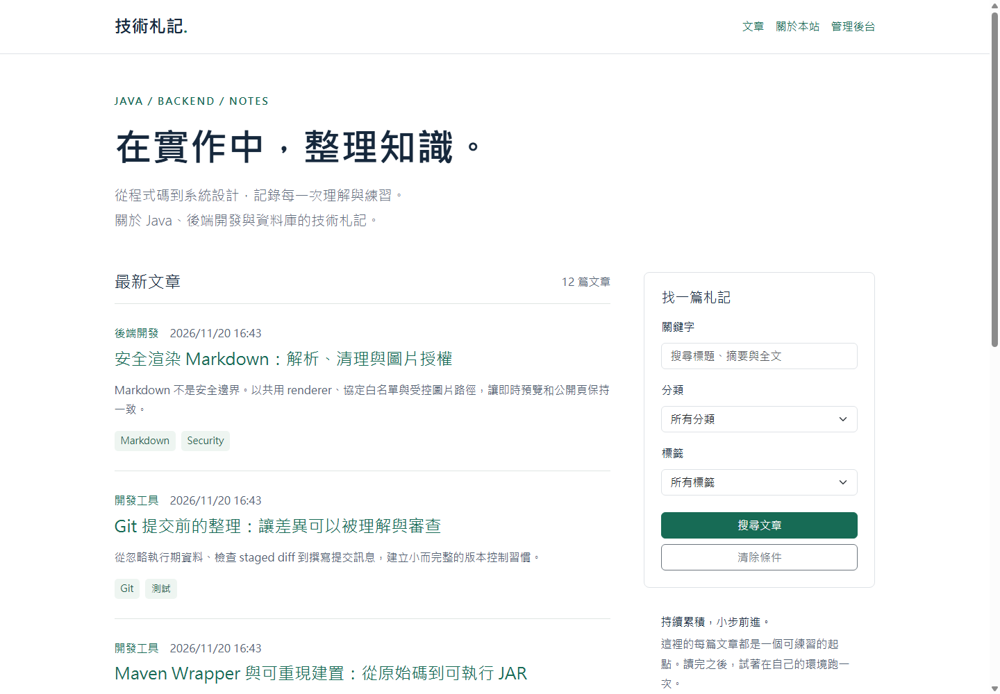
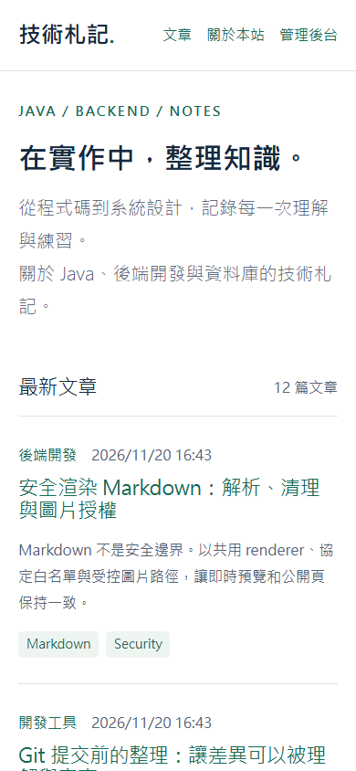
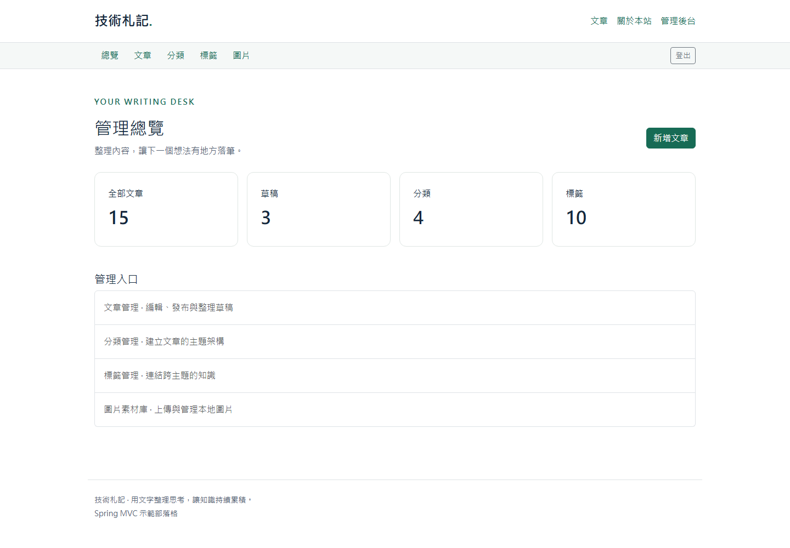
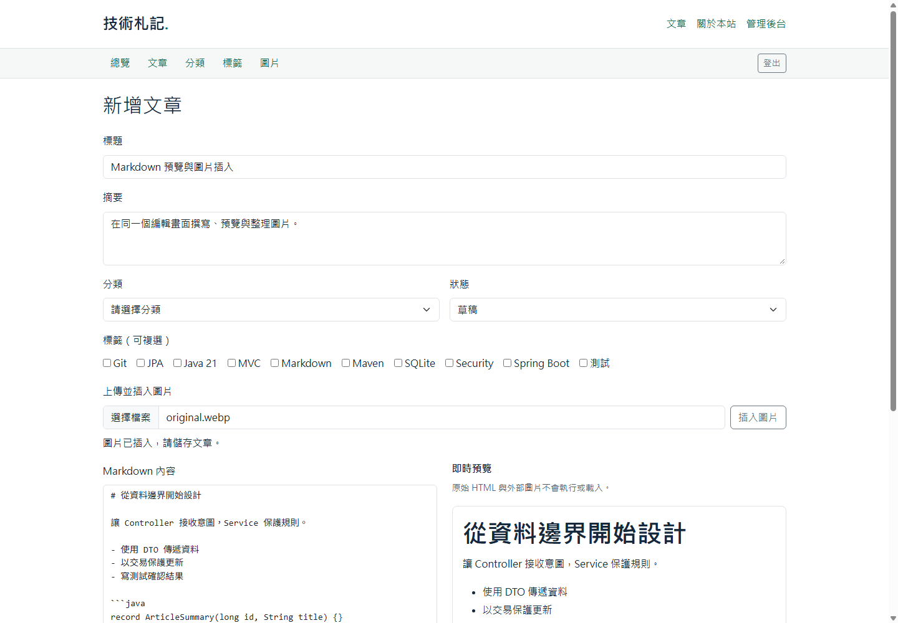

# 技術札記 · Personal Blog System

Java 21 的個人技術部落格，使用 Spring MVC、Thymeleaf、SQLite 與 Spring Security。訪客免登入閱讀，單一管理員維護文章、分類、標籤與圖片。介面為繁體中文、白底 RWD，前端資源全部本地載入。

本專案由 AI 輔助開發；示範文章由 AI 原創撰寫，並非個人職涯經歷。示範 PNG 為開發時由 Java 繪製的原創幾何圖示。網站執行時不呼叫 AI、雲端服務或 CDN。

## 快速啟動

只執行交付 JAR 需要 **Java 21** 與可寫的工作目錄，不需要 Maven、Node、Python 或資料庫伺服器。

```powershell
# 在專案根目錄；或改用獨立交付檔 delivery/personal-blog.jar
java -jar target/personal-blog.jar
```

開啟 <http://127.0.0.1:8080>，後台為 <http://127.0.0.1:8080/admin>。以 `Ctrl+C` 停止。

**本機 demo 預設帳號：`admin`；密碼：`DemoBlog!2026`。** 預設 profile 為 demo，僅綁定 `127.0.0.1`。正式環境不得使用此展示密碼。

首次啟動建立 `./data/blog.db` 與 `./data/uploads/`，初始化 4 個分類、10 個標籤、12 篇已發布文章、3 篇草稿、6 張 PNG。種子資料在同一交易中完成才寫入 `seed_version=1`；重啟不覆寫帳號，也不重複載入或補回已刪除文章。

可將 JAR 複製到任意可寫目錄再執行，或指定資料位置與埠號：

```powershell
java -jar delivery/personal-blog.jar --app.data-dir=./my-blog-data --server.port=8081
```

相對路徑以**啟動時工作目錄**為準，重新啟動請使用同一工作目錄或相同的絕對資料目錄。程式不寫死本機路徑；避免多個程式同時使用同一份 DB。

## 在 VS Code 開發與驗收

1. 安裝 JDK 21，確認 `java -version`。以 VS Code 開啟專案根目錄；Java Extension Pack 可選用。
2. 在整合式終端機執行下列 Wrapper 命令。首次建置需要網路下載 Maven 及 Maven Central 的依賴，不需全域安裝 Maven。
3. 開啟首頁，確認每頁六篇與下一頁；合併關鍵字、分類、標籤搜尋，並檢查無結果提示。
4. 登入後台，新增草稿、預覽 Markdown、插入上傳圖片；儲存並編輯、發布、撤回，再確認前台與圖片的公開權限。
5. 依 [完整驗收清單](docs/ACCEPTANCE.md) 操作分類、標籤與圖片刪除防護。
6. 修改／刪除一篇文章，停止程式後以相同資料目錄重啟，確認變更仍保留。

Windows PowerShell：

```powershell
.\mvnw.cmd test
.\mvnw.cmd spring-boot:run
.\mvnw.cmd clean verify
```

Linux / macOS：

```bash
chmod +x mvnw
./mvnw test
./mvnw spring-boot:run
./mvnw clean verify
java -jar target/personal-blog.jar
```

建置成功產生 `target/personal-blog.jar`。依賴快取若需指定可使用 `-Dmaven.repo.local=<目錄>`；本次環境驗證使用專案內忽略的 `.m2/repository`，一般使用者不必加此參數。

## 功能

| 前台 | 後台 |
| --- | --- |
| 已發布文章清單，每頁 6 篇 | Session 登入、POST 登出、BCrypt |
| 標題／摘要／全文關鍵字搜尋 | 文章新增、編輯、刪除與狀態搜尋分頁 |
| 分類與標籤合併篩選 | 草稿、發布、撤回與發布時間規則 |
| 安全 Markdown 全文與受控圖片 | 與前台共用規則的即時預覽、上傳插入圖片 |
| 關於本站、手機版與錯誤頁 | 分類／標籤 CRUD、去空白、大小寫重複檢查 |
| 草稿與不存在文章 404 | 圖片素材庫、複製 Markdown、引用刪除防護 |
| Asia/Taipei 日期顯示 | 文章、草稿、分類、標籤統計 |

## 架構與程式入口

瀏覽器 → Controller → Service → Repository → SQLite；Thymeleaf 只接收 DTO。完整檔案樹與每層職責見 [PROJECT_TREE.md](docs/PROJECT_TREE.md)。

| 路徑 | 職責與主要機制 |
| --- | --- |
| `controller/` | 接收並驗證 DTO，回填錯誤或 PRG；有限 JSON 用於預覽與圖片上傳。 |
| `service/` | 交易、分類存在性、發布時間、引用防護、安全 Markdown、檔案補償與初始化。 |
| `repository/` | JPA 存取與參數化查詢；分頁後批次載入標籤，避免 collection fetch join 分頁與 N+1。 |
| `entity/` | 單向 LAZY 關聯、狀態更新；Instant converter 固定九位小數 UTC 字串。 |
| `dto/` | 表單 Bean Validation、列表／全文／圖片與統計資料；不從表單綁定 Entity。 |
| `config/` | 每條 SQLite 連線啟用外鍵、schema-v1、保守單連線池、安全鏈、依序啟動初始化。 |
| `resources/db/` | 明確 DDL、CHECK、UNIQUE、FK 與索引；不使用 Hibernate create-drop。 |
| `resources/seed/` | 原創文章、metadata 與六張 PNG；執行期不需產生內容。 |

`PostService` 負責首次發布設時間、撤回清空與重發重新計時。`MarkdownService` 使用 CommonMark + jsoup，跳脫 raw HTML、限制連結協定與本站圖片路徑。`ImageService` 驗證 MIME／簽章、實際解碼、尺寸及 5 MiB 上限，以 UUID 儲存；圖片只對管理員或已發布文章引用開放。

檔案不能加入一般資料庫交易，因此上傳在 DB 回滾時移除新檔；刪除先移至 `.deleted`，提交才清除、回滾則還原。啟動時依 metadata 修復中斷刪除與清除孤兒檔案。種子初始化失敗同樣補償圖片，不留下成功標記。

## 設定與正式模式

| 設定 | 環境變數 | 預設／用途 |
| --- | --- | --- |
| `app.data-dir` | `BLOG_DATA_DIR` | `./data`，DB 與 uploads 的根目錄 |
| `app.seed.enabled` | `BLOG_SEED_ENABLED` | demo 為 true，prod 為 false |
| `app.admin.initial-password` | `BLOG_ADMIN_PASSWORD` | 只在 admin 不存在時使用 |
| `server.port` | `PORT` | 8080 |
| `server.address` | `SERVER_ADDRESS` | 127.0.0.1 |
| `spring.profiles.active` | `SPRING_PROFILES_ACTIVE` | 未指定時採 demo |

正式模式首次啟動需從安全環境變數提供初始密碼，至少 12 字、UTF-8 不超過 72 位元組，且不能等於展示密碼。缺少密碼會啟動失敗；已有 admin 時不覆寫密碼。

```powershell
# 先由作業系統／秘密管理機制設定 BLOG_ADMIN_PASSWORD，再執行
java -jar delivery/personal-blog.jar --spring.profiles.active=prod --app.data-dir=./production-data
```

```bash
# BLOG_ADMIN_PASSWORD 先由安全環境注入
java -jar delivery/personal-blog.jar --spring.profiles.active=prod --app.data-dir=./production-data
```

prod 啟用 Secure Session cookie，實際瀏覽器登入需 HTTPS；可由部署環境設定 TLS 或可信反向代理。未配置 HTTPS 的 localhost 展示請維持 demo。初始密碼不會寫入日誌。不要將 demo 已初始化的資料庫直接當成正式資料；請使用獨立資料目錄。產品規格未包含變更密碼 UI。

若要空白展示庫，可設定 `BLOG_SEED_ENABLED=false`，但仍會建立管理員。既有種子版本標記會永久阻止重灌示範內容；若要重新展示，請另外指定全新目錄，避免刪除既有資料。

備份／搬移時先停止程式，再一起複製整個資料目錄，包含 DB 與 uploads。單獨複製 DB 會漏掉圖片。

## 程式碼格式與整理版本

專案以 `.editorconfig` 統一 UTF-8、4 空格縮排、LF 與檔尾換行；Windows 命令檔保留 CRLF，Markdown 保留有語意的行尾空白，第三方資源維持原始格式。

HTML／Thymeleaf 依父子層級排版，長屬性換行；會影響文字間距的行內元素保留相鄰關係。CSS 每個宣告獨立一行，以功能註解區分區塊，維持既有選擇器與宣告順序。JavaScript 與 Java 維持原有邏輯，Java import 使用明確型別。

本次整理後的獨立交付檔為 `delivery/personal-blog-formatted.jar`，校驗值在同名 `.jar.sha256` 檔案。原有 JAR、ZIP 與校驗檔保留原版本；最新格式化原始碼以目前工作目錄為準。

```powershell
java -jar delivery/personal-blog-formatted.jar
```

整理項目、完整修改清單、Maven 測試與畫面比對結果見 [FORMATTING_REPORT.md](docs/FORMATTING_REPORT.md)。

## 測試與實際交付驗證

`mvnw.cmd clean verify` 執行 JUnit 5／MockMvc 與真實 SQLite 暫存檔測試。詳細結果、測試類別與實際命令見 [TEST_REPORT.md](docs/TEST_REPORT.md)。

附加的開發驗證腳本不屬於網站執行依賴：

```powershell
# Python 3，僅用標準函式庫；自動啟動／停止 JAR 兩次，保留驗收資料於 target
python scripts/jar-smoke.py

# Node 22+ 與本機 Chrome；直接使用 DevTools Protocol，不需 npm install
node scripts/browser-check.mjs

# Java 21 重新產生原創示範 PNG
java scripts/GenerateSeedImages.java
```

瀏覽器腳本預設測試正在 `127.0.0.1:8080` 執行的 demo，驗證登入、手機／桌面、預覽與圖片上傳，成功後會刪除該張測試圖片；請使用獨立測試資料目錄。可用 `BLOG_TEST_URL` 與 `CHROME_PATH` 指定網址和瀏覽器路徑。截圖存於 `docs/screenshots/`。

## 畫面

首頁桌面版：



首頁手機版：



管理總覽與編輯預覽：




## 交付、授權與限制

`delivery/personal-blog.jar` 是獨立執行檔，`delivery/personal-blog-source.zip` 是排除執行資料與建置快取的原始碼；雜湊在 `delivery/SHA256SUMS.txt`。原始碼尚未由工具自動建立 Git 提交、上傳或發布，由使用者決定。

SQLite 與本機檔案設計以單一程式、單一管理員為範圍，未提供多節點、全文搜尋引擎、會員、留言或外部服務整合。關鍵字採 SQL LIKE，英文字母大小寫不敏感，`%`、`_` 與反斜線作字面搜尋。圖片最多 5 MiB、單邊最多 10000 px、總像素最多 2500 萬；只允許 JPEG／PNG／WebP，外部圖片不渲染。

已驗證 Windows／Java 21；Unix Wrapper 與外部路徑設計已提供，尚未在 Unix 主機實跑。測試過程中的 Mockito 動態 agent 警告不影響結果。第三方套件與授權說明見 [THIRD_PARTY.md](docs/THIRD_PARTY.md)。沒有未實作功能或待辦占位。
